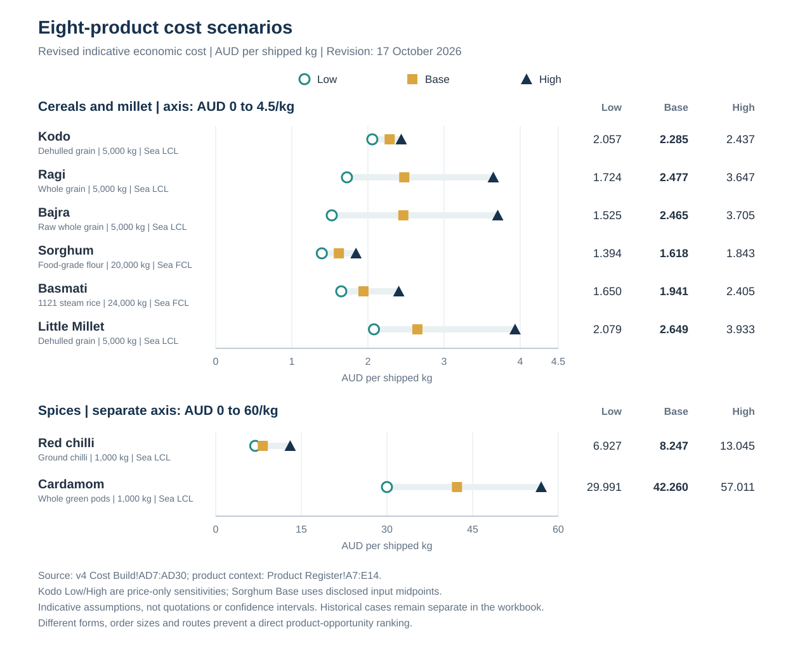
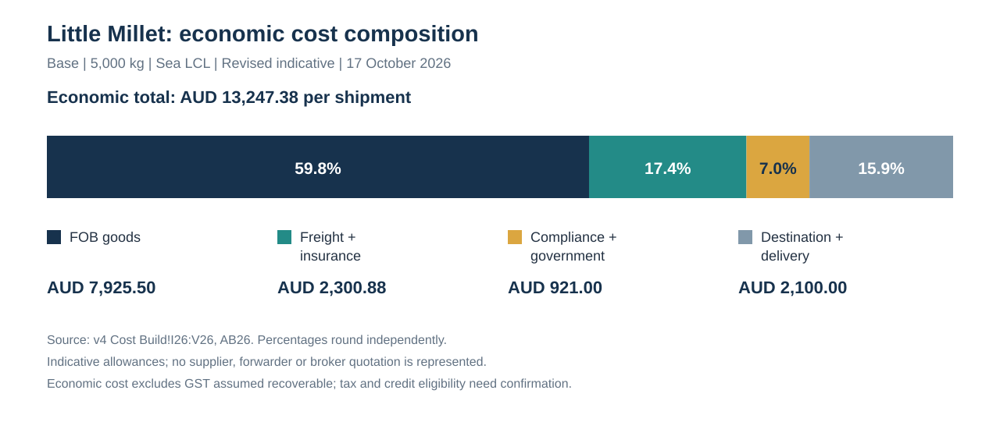
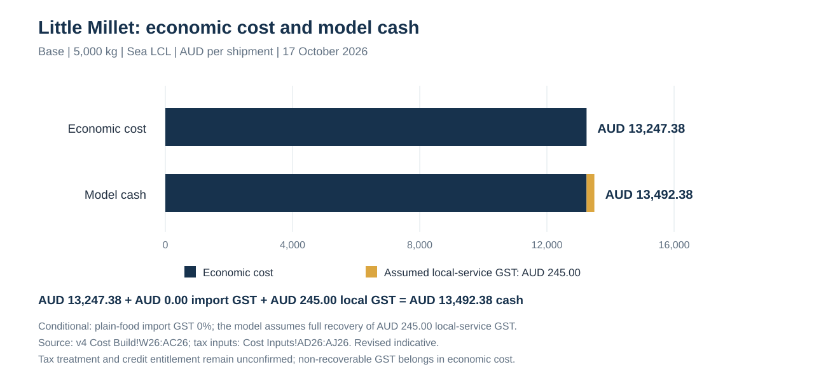
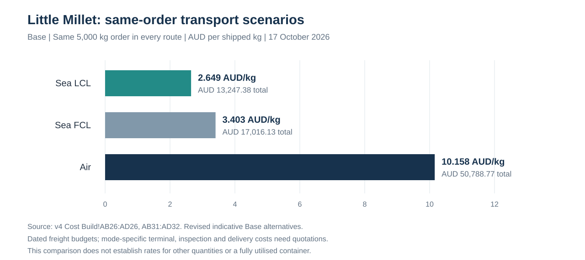

# Australia Product Intelligence & Landed Cost Dashboard

**Making import costs, cash requirements and evidence gaps clear for management.**

**Business problem:** Liberty Exports' product research was spread across separate spreadsheets with different shipment sizes, cost assumptions and incomplete scenarios. Management needed a consistent way to review the likely shipment budget, understand the cash required and identify what still needed confirmation.

**My contribution:** I consolidated eight India-to-Australia product studies, rebuilt the cost calculations around editable inputs, corrected calculation and scenario-selection issues, and translated the findings into two Excel dashboards and an annotated management report.

**Completed result:** A traceable decision-support model showing estimated costs, major cost drivers, cash differences and commercial verification priorities. All cost figures remain **Indicative**; commercial outcomes have not yet been measured.

| Product cases | Revised primary scenarios | Management dashboards | Review report |
|---:|---:|---:|---:|
| **8** | **24** | **2** | **8 pages** |

[Read the manager review report](portfolio-v4/Liberty_Australia_Manager_Dashboard_Review_Report_SybilYan_v2.pdf) · [Explore the static 24-case extract (CSV)](portfolio-v4/v4_cost_scenario_outputs.csv)

Prepared by **Sybil Yan** for manager review at **Liberty Exports**. Analytical revision: **17 October 2026**. Original research dates are retained for each product; this README was updated on 18 October 2026.

## Business problems addressed

| Business problem | What I changed | What management can now review |
|---|---|---|
| Fragmented research made comparisons difficult. | Combined product, cost and market evidence; standardised the overview to **AUD per shipped kg**, retaining the original product forms, quantities, routes and dates. | Eight product cases in one reporting structure, with the context needed to interpret each comparison. |
| Calculation discrepancies and missing scenarios weakened the cost analysis. | Reconciled component costs, preserved the Little Millet insurance corrections, repaired route selection and Cardamom's duty-to-cash logic, and documented new Kodo and Sorghum planning cases. | **24 revised primary cases**, supported route alternatives and a correction trail alongside **21 historical cases**. |
| Economic cost and shipment cash needs were easy to confuse. | Separated pre-GST costs, duty, import GST, local-service GST, assumed credits and non-recoverable amounts. | A clear explanation of the modelled cost-to-cash difference and the tax assumptions requiring confirmation. |
| Management needed to know which expenses warranted further enquiry. | Broke costs into goods, freight/insurance, compliance/government, destination and other expenses; exposed FOB/FCA inclusion assumptions. | The main cost drivers and the supplier, forwarder or broker evidence needed to test them. |
| Retail prices and broad trade statistics could be mistaken for proven demand. | Refreshed **16 retail references**, retained pack, specification and date limitations, and kept separate trade-category series through **2025**. | Market context with clear limits; achievable wholesale prices and buyer demand remain open questions. |
| Outstanding evidence was difficult to communicate. | Created product-level verification and action registers, supported by an eight-page report with findings, interpretations, limitations and source locations. | A structured follow-up list for import pathways, suppliers, logistics, tax, buyers and labels. |

## Eight-product cost overview

The scope covers **Kodo millet, Ragi, Bajra, Sorghum flour, Basmati rice, Red Chilli Powder, Little Millet and Cardamom**.

**How to read this:** Compare scenarios within each product's shipment context. Different product forms, order sizes, destinations and research dates prevent a direct opportunity ranking by unit cost. Low/Base/High are planning assumptions, not statistical confidence intervals.

- Kodo Low/High are new **price-only sensitivities** based on the original report's USD 0.70–0.95/kg range; other revised Base-case assumptions are held constant.
- Sorghum Base is a new **input-midpoint planning case**, clearly distinguished from an original Base result or the average of final totals.
- Cardamom retains its **1,000 kg / FCA / sea LCL / Sydney** context. The overview uses shipped kilograms; its separate saleable-kg calculation retains the source model's **assumed 99% yield**.
- Unsupported product/scenario/route combinations display **Not available**. The model does not silently substitute another case.

## Example: what the Little Millet model explains

The default case is **5,000 kg of dehulled Little Millet, sea LCL to Melbourne**, with delivery to an illustrative warehouse 30 km from port. It retains the original 4 October 2026 research inputs and an AUD 1.441 per USD commercial conversion rate. The 17 October revision date does not indicate a new freight or FX quotation; actual customs valuation and FX still require confirmation.

| Revised Base-case measure | Model result |
|---|---:|
| Economic shipment cost | **AUD 13,247.38** |
| Economic cost per shipped kg | **AUD 2.649** |
| Model cash requirement | **AUD 13,492.38** |
| Non-goods share of economic cost | **40.2%** |

The non-goods share makes freight, destination handling, clearance and delivery useful priorities for itemised quotations. The model identifies where to investigate; it does not demonstrate negotiated savings.

The **AUD 245.00** difference is the model's local-service GST provision. Import GST is conditionally modelled at 0% for the proposed plain-food case, while full local-service GST recovery is assumed. Product-specific tax treatment, invoice allocation and the importer's credit entitlement still need confirmation. The revised cash figure reflects changed assumptions and is **not a realised saving**.

Under these dated inputs, FCL is approximately **28.4%** above LCL, while air is approximately **3.83 times** LCL. This comparison applies to the supported 5,000 kg Base routes; shipment-specific quotations are needed before choosing a mode.

## My analysis and validation work

- **Data consolidation and quality:** aligned product identities, shipment contexts, currencies, FX direction, cost categories and evidence dates; retained source references and historical results.
- **Cost and scenario modelling:** built formula-driven inputs and cost calculations; separated economic cost from cash and conditional GST recovery; checked potential duplication of FOB/FCA origin charges.
- **Management reporting:** developed two linked Excel views with **14 native charts** across nine worksheets, using one product/case/basis selector set and a separate trade-category selector.
- **Response to feedback:** added Cardamom, repaired scenario linkage, documented the new planning cases and made commercial evidence gaps explicit.
- **Verification:** reconciled saved results against independent arithmetic; tested **48 product/case/basis combinations** and **14 input changes**, including nonzero duty, GST recovery changes and missing inputs. The saved workbook scan found **no formula errors**. All eight PDF pages were rendered and visually reviewed.

The project demonstrates **business analysis, Excel reporting, data validation, scenario analysis, commercial cost modelling, evidence evaluation and management communication**.

## What still needs commercial validation

| Open question | Evidence needed before progressing |
|---|---|
| Can the exact product be imported under the proposed conditions? | Botanical identity, processing and viability evidence; the current product-specific BICON branch, treatments or permits; final tariff classification. |
| What will the shipment actually cost? | Valid supplier and itemised freight, CFS, broker, inspection and warehouse-delivery quotations; confirmed FOB/FCA inclusions. |
| What tax applies, and can it be recovered? | Transaction-specific duty/GST treatment, customs valuation/FX, invoices and importer credit eligibility. |
| Is there a buyer at a viable wholesale price? | Buyer specification, purchase interest, wholesale price basis, MOQ and label requirements. |

These are follow-up requirements, not completed approvals. Retail prices are not wholesale quotations, and broad HS trade categories are not proof of demand for a particular proposed grade. No realised sales, profit, reporting-time reduction or cost-saving percentage is claimed.

## Files and evidence

- **Scenario outputs:** [static 24-case CSV extract](portfolio-v4/v4_cost_scenario_outputs.csv), taken from the final workbook with shipment context, evidence dates and source-cell references. `Not available` is preserved where the source fee/GST bundle cannot support a separate cash figure.
- **Excel model structure:** the interactive workbook is retained locally. It contains `Dashboard`, `Manager Dashboard`, `Cost Inputs`, `Cost Build`, `Product Register`, `Cost Evidence`, `Market Evidence`, `Action Register` and `Sources & Definitions`. The two dashboard views use the same selections. The public CSV and report provide the scenario results and source map.
- **Current report:** [v2 manager review, eight pages](portfolio-v4/Liberty_Australia_Manager_Dashboard_Review_Report_SybilYan_v2.pdf). Each analysis figure includes a finding, interpretation, limitation and source; page 8 maps the report back to workbook cells.
- **Historical report:** [v1 manager review, six pages, 5 October 2026](Liberty_Australia_Manager_Dashboard_Review_Report_SybilYan_v1.pdf). This preserves the earlier seven-product review and its historical assumptions; the current results above use the revised model.

**Decision supported:** review the shipment budget, understand funding needs and prioritise evidence collection before a commercial commitment.
